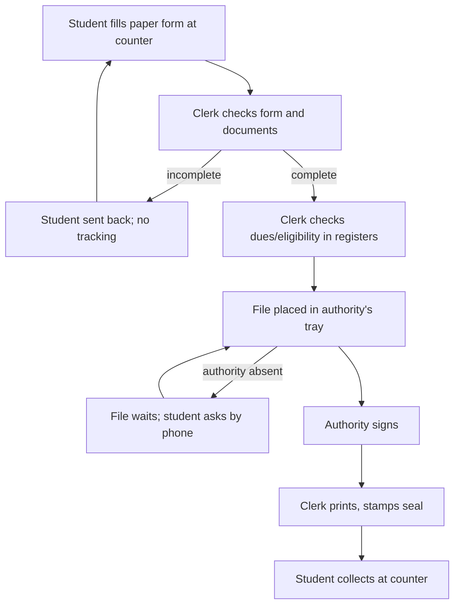

# Current-state process map (SYNTHETIC / ILLUSTRATIVE, replace with your observed map)

| Step | Who (role) | Handoff medium | Approval point | Exceptions |
|---|---|---|---|---|
| Submit | Student | Paper | none | missing purpose or documents |
| Check | Clerk | Paper | clerk completeness check | duplicate/repeat request not noticed |
| Eligibility | Clerk | Register | rule check | dues pending |
| Sign | Authority | Tray | **signature** | authority absent, delay |
| Issue | Clerk | Counter | seal | lost file |
| Collect | Student | Counter | ID check | someone else collecting |
