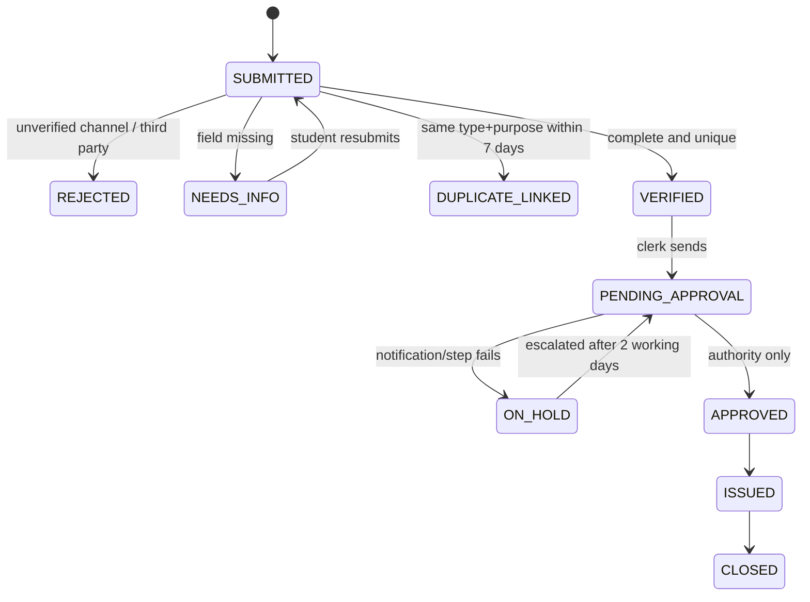

# Proposed process

- **Inputs:** certificate type (list), purpose, copies, required-by date, document checklist ticked, verified college login, consent line.
- **Statuses:** SUBMITTED, NEEDS_INFO, VERIFIED, PENDING_APPROVAL, APPROVED, ISSUED, CLOSED, plus REJECTED, DUPLICATE_LINKED, ON_HOLD.
- **Accountable owner:** Academic Office desk in-charge (a role). Owns the queue, the 2-working-day escalation rule and the weekly exception review.
- **Approval boundaries:** the tool/clerk may check completeness, detect duplicates, route and remind. Only the designated authority may approve. Eligibility decisions and signatures are never automated. Every approval is logged with date and role.
- **Fallback:** if the tool or a step fails, the request moves to ON_HOLD, then the existing paper/email path runs within 1 working day under the same request ID.
